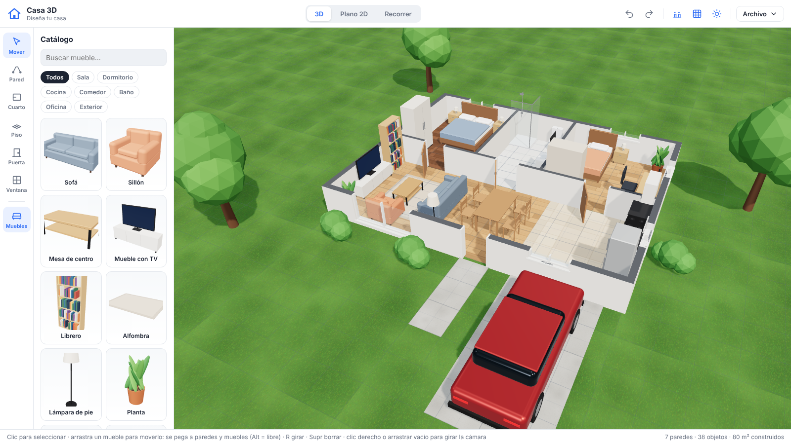
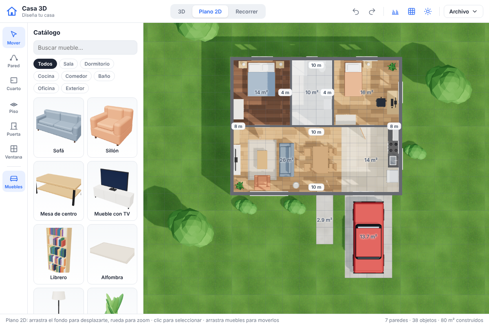
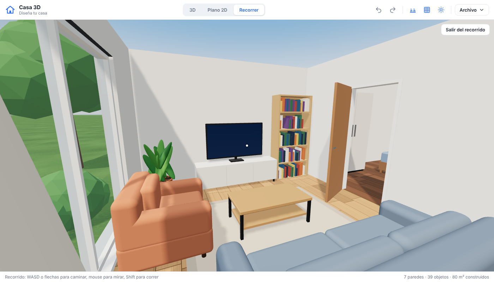
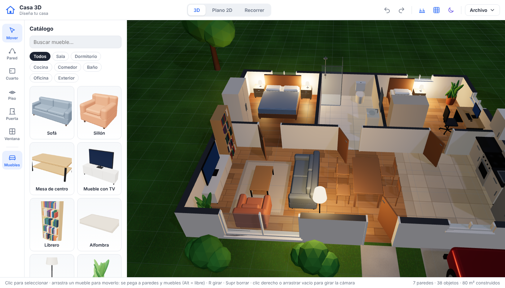

# 🏠 Casa 3D — Diseña tu casa

Diseñador de casas en 3D hecho con **Three.js**. Dibuja paredes y habitaciones, coloca puertas, ventanas y pisos, amuebla cada cuarto y recorre la casa en primera persona. Todo es procedural: los muebles, las texturas de piso y el pasto se generan con código, sin modelos ni imágenes externas.



| Plano 2D | Recorrido | Noche |
| --- | --- | --- |
|  |  |  |

## Qué puedes hacer

- **Paredes:** clic en cada esquina, con imán a la cuadrícula, a las esquinas existentes y a los ángulos rectos. Muestra el largo en vivo.
- **Habitaciones:** arrastra un rectángulo y se crean las 4 paredes y el piso de una vez.
- **Pisos:** roble, nogal, cerámica, porcelanato, mármol, damero, alfombra, concreto y jardín.
- **Puertas y ventanas:** puerta, puerta doble, vano libre, ventana, ventana alta y ventanal. Se colocan sobre cualquier pared con vista previa (verde si cabe, rojo si no).
- **27 muebles** en 7 categorías: sala, dormitorio, cocina, comedor, baño, oficina y exterior, incluido el carro.
- **Imán y choques:** al mover o colocar un mueble se pega a las paredes y a los muebles cercanos. Si choca con algo se pone rojo y te dice con qué choca.
- **Editar:** mover arrastrando, girar, cambiar color, subir de altura (por ejemplo, la computadora sobre el escritorio), duplicar y eliminar. También pintar paredes y cambiar su grosor y altura.
- **Vistas:**
  - **3D** con paredes cortadas para ver adentro.
  - **Plano 2D** con medidas de cada pared y m² de cada cuarto.
  - **Recorrido en primera persona** con colisiones: las paredes no se atraviesan y las puertas sí.
- **Día y noche:** de noche se encienden las lámparas.
- **Deshacer y rehacer** ilimitado, guardado automático en el navegador y exportar/importar el diseño en `.json`.

## Atajos

| Tecla | Acción |
| --- | --- |
| `1`–`6` | Mover, Pared, Cuarto, Piso, Puerta, Ventana |
| `R` / `Shift+R` | Girar 90° / 15° |
| `Supr` | Eliminar selección |
| `Ctrl+Z` / `Ctrl+Y` | Deshacer / rehacer |
| `Ctrl+D` | Duplicar mueble |
| `Esc` / `Enter` | Cancelar / terminar la pared |
| `G` | Mostrar u ocultar la cuadrícula |
| `Alt` al arrastrar | Mover sin imán |
| `WASD` + mouse | Caminar en el recorrido (`Shift` para correr) |

## Cómo ejecutarlo

No necesita compilación. Three.js se carga desde un CDN, pero los módulos ES requieren un servidor local:

```bash
npx serve .
# o
python -m http.server 8080
```

Para publicarlo en GitHub Pages: **Settings → Pages → Deploy from a branch → `main` / root**.

## Estructura

```
index.html       Interfaz: barra superior, herramientas, catálogo, paneles
style.css        Estilos de la interfaz
src/
  app.js         Escena, cámaras, herramientas, selección, deshacer, recorrido, día/noche
  build.js       Paredes con huecos, puertas, ventanas, pisos y texturas procedurales
  catalog.js     Catálogo de muebles construidos con geometría
  example.js     Casa de ejemplo (sala-comedor-cocina, 2 dormitorios y baño)
```
